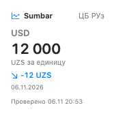
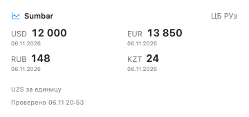
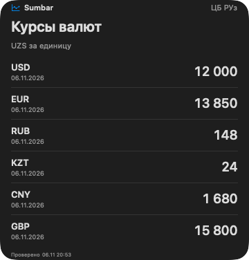

# Виджеты Sumbar для macOS

[Установка приложения](INSTALLATION.md) · [Руководство пользователя](USER_GUIDE.md) · [Конфиденциальность](PRIVACY.md)

Виджеты показывают официальные курсы ЦБ Узбекистана в правой панели Центра уведомлений и на рабочем столе. Нужны **Sumbar 0.6.0 или новее** и **macOS 14 или новее**. Регистрация и подписка не требуются.

## Как добавить виджет

1. Установите `Sumbar.app` в «Программы» и один раз запустите приложение. При обновлении сначала завершите старую Sumbar и замените её новой сборкой.
2. Нажмите дату и время справа в строке меню, чтобы открыть Центр уведомлений.
3. Нажмите **«Изменить виджеты»** и найдите **Sumbar**.
4. Выберите «Курс валюты» или «Курсы валют», затем размер. Добавьте виджет в панель или перетащите его на рабочий стол.
5. Завершите редактирование. Чтобы изменить валюту или язык, нажмите добавленный виджет правой кнопкой и выберите пункт его редактирования.

Галерею также можно открыть из контекстного меню рабочего стола → «Изменить виджеты». Если последний опубликованный релиз ниже 0.6.0, дождитесь версии с виджетами или используйте [сборку из исходников](../CONTRIBUTING.md).

## Какой виджет выбрать

| Виджет | Размер | Что показывает |
| --- | --- | --- |
| Курс валюты | Маленький | Одну валюту: курс, изменение в UZS, дату действия и время проверки |
| Курс валюты | Средний | Тот же курс с отдельным блоком изменения и даты действия |
| Курсы валют | Средний | Четыре валюты с датами действия и общим временем проверки |
| Курсы валют | Большой | Шесть валют с датами действия и общим временем проверки |

Маленький виджет одной валюты:

Средний список курсов:

Большой список в тёмной теме:

На изображениях — демонстрационные значения из локального рендеринга интерфейса, а не действующие котировки. Оформление на рабочем столе также зависит от настроек виджетов macOS.

## Валюта, язык и несколько экземпляров

В меню редактирования виджета доступны:

- **Валюта:** USD, EUR, RUB, KZT, CNY, GBP, CHF, JPY, KRW, TRY, AED или KGS.
- **Язык:** как в macOS, русский или узбекский. Этот выбор независим от языка основного приложения.

В списке выбранная валюта идёт первой. Остальные берутся из USD, EUR, RUB, KZT, CNY и GBP без повторений; средний размер показывает первые четыре, большой — первые шесть. Отдельного выбора каждой строки пока нет.

Можно добавить несколько экземпляров с разными валютами и языками. Их настройки не меняют избранное и показатель строки меню Sumbar. Нажатие на курс открывает соответствующую валюту в приложении, сохраняя закрепление строки меню. Размер и удаление доступны через контекстное меню виджета.

## Обновление и даты

Виджеты запрашивают ЦБ самостоятельно: основное приложение может быть закрыто. Sumbar просит macOS обновить виджет примерно через 30 минут; фактическое время определяет система с учётом энергии и активности. Интервал 15/30/60 минут в настройках основной панели на виджеты не влияет.

Цены приведены к **одной единице иностранной валюты в UZS**, с учётом номинала источника. Изменение относится к предыдущей публикации ЦБ. Оно не означает прибыль или убыток пользователя. Официальный курс не является предложением обмена банка.

Дата возле курса — дата действия публикации. **«Проверено»** — время успешного получения данных. Все даты данных отображаются по Ташкенту; новая проверка не меняет дату публикации. В выходной может действовать предыдущий курс.

| Состояние | Значение |
| --- | --- |
| «Проверено» и время | Последняя загрузка успешна, проверка не старше часа |
| «Сохранённые данные» или «Сохранено» в маленьком виджете | Последняя попытка не удалась либо проверка старше часа; показано исходное время успешной загрузки |
| Прочерк | Подходящего курса нет: ещё не было загрузки, валюта отсутствует в ответе, публикация ещё не действует или ей уже восемь дней |
| «Нет данных · проверьте сеть» | Нет сохранённого ответа, который можно показать |

Примеры из галереи не подставляются вместо отсутствующих реальных данных. Последний успешный ответ хранится локально в отдельном контейнере виджета; подробности — в [конфиденциальности](PRIVACY.md).

## Если что-то не работает

| Ситуация | Что сделать |
| --- | --- |
| Sumbar нет в галерее | Нужна версия 0.6.0+. Установите собранный `.app` в «Программы», запустите его и заново откройте галерею. `swift run` не устанавливает расширение |
| Курс ещё не появился | Проверьте сеть и дождитесь загрузки. Галерея может показывать пример до первого реального ответа |
| Приложение обновилось, а виджет показывает сохранённые данные | У них раздельные запросы и кэш; дождитесь следующего обновления по расписанию macOS |
| Нужная валюта не первая | Откройте редактирование именно этого экземпляра и выберите валюту |
| Язык отличается от приложения | Выберите русский, узбекский или системный язык в настройках самого виджета |
| Нет банков или бумаг | Виджеты показывают курсы ЦБ; сравнение банков и котировки бумаг доступны в основной панели |

Если проблема повторяется, [создайте GitHub Issue](https://github.com/ahrik/sumbar/issues), указав версии Sumbar и macOS, тип и размер виджета, валюту и показанное состояние. Не прикладывайте целиком личные файлы кэша и правил уведомлений.
